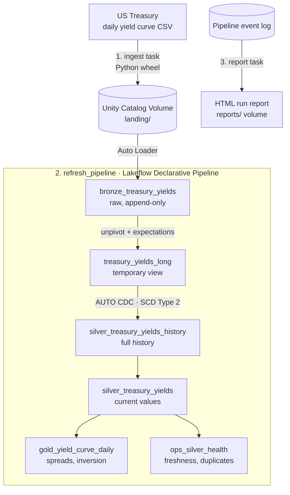

# macro-lakehouse

## Overview

macro-lakehouse is an automated Databricks lakehouse that downloads daily US Treasury
par yield curve data, cleans and validates it, and turns it into analysis-ready
recession indicators such as the 10-year minus 2-year spread, which has turned
negative ("inverted") ahead of most US recessions.

The dataset looks simple but raises real data engineering problems, each solved
with a specific Databricks feature:

| Problem | Solution |
|---|---|
| New files arrive daily and must be loaded once | **Auto Loader** picks up only new CSV files |
| Wide, messy CSV headers ("1 Mo", "1.5 Month"), new maturities added over time | Header standardisation, **unpivot** to long format, schema evolution |
| Bad or missing values | **Data quality expectations** that drop bad rows or stop the pipeline |
| Published values can be revised | **SCD Type 2** history via AUTO CDC, enabling point-in-time queries |
| Reruns must be safe | Idempotent loads: reloading a year never creates duplicates |
| Failures must be visible | An automated **run report** built from the pipeline event log |

## Architecture

A Databricks Job runs three tasks in order. Ingest downloads the CSVs into a Unity Catalog volume, refresh_pipeline runs the declarative pipeline from bronze to gold, and report reads the pipeline’s event log to produce an HTML run report. The report task uses run_if: ALL_DONE, so a report is produced even when the pipeline fails, which is exactly when you need it most.

## Tech stack

| Tool | What it does here | Why this choice |
|---|---|---|
| **Databricks (serverless)** | Runs the job, pipeline and Python tasks | No clusters to size or manage; pay only while it runs |
| **Lakeflow Declarative Pipelines** | Defines bronze → silver → gold as tables in Python | Declares *what* each table is; Databricks handles ordering, retries and incremental updates |
| **Auto Loader** | Loads new CSV files from the landing volume | Tracks which files it has already processed, so each file loads exactly once |
| **AUTO CDC (SCD Type 2)** | Keeps the full history of every yield value | Treasury can revise published numbers; history allows point-in-time queries |
| **Delta Lake** | Storage format for all tables | ACID transactions, time travel and safe MERGE operations |
| **Liquid clustering** | Organises silver history by date and maturity | Speeds up the most common filters without managing partitions |
| **Unity Catalog** | Catalog, schema, volumes and table permissions | One place for governance, lineage and access control |
| **Lakeflow Jobs** | Orchestrates ingest → pipeline → report | Task dependencies, plus `run_if: ALL_DONE` so the report runs even after a failure |
| **Databricks Asset Bundles** | Deploys the job, pipeline and catalog objects from YAML | Infrastructure as code: repeatable, reviewable deployments from Git |
| **Python + uv** | Ingestion and report code, packaged as a wheel | uv gives fast, reproducible installs and builds the wheel the job runs |
| **pytest + ruff** | Unit tests and linting | Catches bugs and style issues before anything is deployed |
| **matplotlib** | Charts in the HTML run report | Simple, dependency-light charting for a static report |

## Data source

**US Department of the Treasury: Daily Treasury Par Yield Curve Rates**
([treasury.gov](https://home.treasury.gov/resource-center/data-chart-center/interest-rates/TextView?type=daily_treasury_yield_curve))

- **What it is:** the yield (%) on US government debt at each maturity, from 1 month to 30 years, published every business day.
- **Format:** one CSV per calendar year, one row per date, one column per maturity.
- **Access:** public, free, no API key.
- **Volume:** small (~250 rows per year), which keeps the focus on correctness rather than scale.

### How it is ingested

The `ingest` job task (`macro_lakehouse.entrypoints:ingest`) downloads every year from
`start_year` (a bundle variable, default 2024) to the current year, and writes each one
as `treasury_<year>.csv` into a run-specific folder in the Unity Catalog `landing` volume.

The download client (`sources/treasury.py`) is built to fail safely:

| Risk | How it's handled |
|---|---|
| Temporary network or server errors | Retries with exponential backoff on 429 and 5xx responses |
| Requests hanging | 30-second timeout |
| An HTML error page returned with status 200 | `validate_csv` checks that the header starts with `Date` before anything is written |
| Client errors such as 404 | Not retried, because retrying would not help |

### Quirks in the data

| Quirk | Example | How it's handled |
|---|---|---|
| Inconsistent headers | `1 Mo`, `1.5 Month`, `10 Yr` | `sanitize_column` turns them into safe names (`t_1_mo`, `t_1_5_month`) |
| Maturities change over time | The 1.5-month and 4-month tenors were added in later years | Auto Loader schema evolution (`addNewColumns`) plus unpivoting to long format, so new maturities need no code changes |
| Wide format | One column per maturity | Unpivoted to one row per (date, maturity) for analysis |
| Maturity is only in the header text | `t_10_yr` | `tenor_months` parses it into months (120); `tenor_label` makes `10Y` |
| Missing values | Some maturities are blank on some dates | Data quality expectations in silver (see Data quality) |
| Published values can be revised | A rate re-published with a correction | SCD Type 2 history in silver (see Data model) |

### Reruns are safe

Each run re-downloads whole years into a new folder, so bronze can receive the same
rows more than once. That is deliberate: bronze stays raw and append-only, and
de-duplication happens in silver, where AUTO CDC keys on (date, maturity). Reloading
a year never creates duplicate silver rows. If a value has changed, it is recorded as
a new version.

## Data model
## Data quality
## Orchestration
## Monitoring
## Testing
## Local setup
## Deployment
## Lessons learned
## What this demonstrates