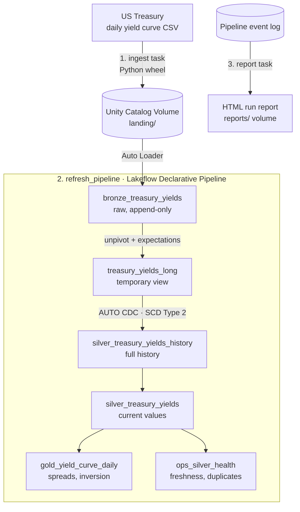

# macro-lakehouse

## Overview

macro-lakehouse is an automated Databricks lakehouse that downloads daily US Treasury
par yield curve data, cleans and validates it, and turns it into analysis-ready
recession indicators such as the 10-year minus 2-year spread, which has turned
negative ("inverted") ahead of most US recessions.

The dataset looks simple but raises real data engineering problems, each solved
with a specific Databricks feature:

| Problem | Solution |
|---|---|
| New files arrive daily and must be loaded once | **Auto Loader** picks up only new CSV files |
| Wide, messy CSV headers ("1 Mo", "1.5 Month"), new maturities added over time | Header standardisation, **unpivot** to long format, schema evolution |
| Bad or missing values | **Data quality expectations** that drop bad rows or stop the pipeline |
| Published values can be revised | **SCD Type 2** history via AUTO CDC, enabling point-in-time queries |
| Reruns must be safe | Idempotent loads: reloading a year never creates duplicates |
| Failures must be visible | An automated **run report** built from the pipeline event log |

## Architecture

A Databricks Job runs three tasks in order. Ingest downloads the CSVs into a Unity Catalog volume, refresh_pipeline runs the declarative pipeline from bronze to gold, and report reads the pipeline’s event log to produce an HTML run report. The report task uses run_if: ALL_DONE, so a report is produced even when the pipeline fails, which is exactly when you need it most.

## Tech stack
## Data source
## Data model
## Data quality
## Orchestration
## Monitoring
## Testing
## Local setup
## Deployment
## Lessons learned
## What this demonstrates